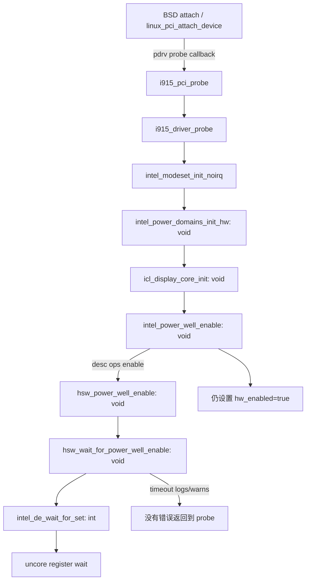

# 固定构建输入与真实接口提供者

证据等级：SOURCE-STATIC。版本沿用 C0，FreeBSD base 候选为 `8c9ce319fef765890ce518cab85d3a470b669849`。`source-lock.json` 记录每项实际字节的 commit/blob/SHA256。本文不是编译命令或可部署模块。

## 构建规则与配置

drm-kmod `i915/Makefile` 的执行次序：先 `../kconfig.mk`，再 `<bsd.kmod.mk>`，之后 `../linuxkpi_version.mk`、`../compiler_flags.mk`，最后追加 LinuxKPI/DRM/i915 的路径和 CONFIG 宏。base `share/mk/bsd.kmod.mk` 允许 `local.kmod.mk`，再引入 `bsd.sysdir.mk` 与 `sys/conf/kmod.mk`；后者通过 `kmod.opts.mk` 引入 `bsd.init.mk`、`kern.opts.mk`、`bsd.compiler.mk`、`config.mk`。因此只拿驱动最后几条 `-I` 不能声称获得有效查找次序。

固定版本的 `kmod.mk` 会重排已有 CFLAGS、设置 `-nostdinc`、添加当前目录/SYSDIR/CK，以及在有 KERNBUILDDIR 时追加该目录；还有 machine/架构链接及 opt_global 强制包含。本轮未完整展开 share/mk 的所有引用，没有执行 BSD make、没有构造架构链接、没有产生有效预处理命令。`build-contract.json.append_order` **仅是驱动末尾七个路径的追加次序**。

| 输入 | 固定源码能确认的事实 | 未验证部分 |
|---|---|---|
| LINUXKPI_VERSION | `linuxkpi_version.mk` 定义 60100 | 不是 Linux/FreeBSD ABI 验收 |
| amd64 | kconfig 的 amd64 分支追加 64BIT、COMPAT、X86_64 等；x86 分支追加 ACPI/ACPI_SLEEP/X86/X86_PAT | 未执行条件求值；不是 HONOR 的 macOS 配置 |
| NO_FBDEV | 为空时添加 DRM_FBDEV_EMULATION 与 OVERALLOC=100 | 不等于 IOFramebuffer 或 WindowServer 桥 |
| CONFIG_PM | 默认 KCONFIG 列含 PM、PM_SLEEP | PM 宏存在不证明 runtime resume 实现 |
| FORCE_PROBE | 默认配置声明通配强制探测 | 不是设备安全/显示支持证据 |
| compiler_types.h | 固定 base 的 LinuxKPI common/include/linux 树没有此项；compiler_flags 使用 exists 条件 | 条件省略，不制造替代头；其他路径提供者尚未闭合 |
| opt headers | 有 KERNBUILDDIR 时链接其 opt 文件；否则一般默认规则创建空文件，特定目标可覆盖 | 未生成；不能把空文件当成实际内核选项 |

`build-contract.json` 固定七组生成关系：bus/device/pci/pci_iov/acpi/fb 的 `.m` 输入对应 makeobjops.awk；vnode_if.src 对应 vnode_if.awk 的 -h/-p/-q 产物。生成器与输入均有实际 blob；产物全部 **NOT_GENERATED**。还必须取得配置、完整 make 包含图、架构链接、工具链及实际预处理依赖，才有资格检查完整对象闭包。

## 调用与提供者

| 关系或接口 | 实际提供者 | 语义与未闭合依赖 |
|---|---|---|
| FreeBSD 驱动注册 | i915_pci.c → linux_pci_register_drm_driver → _linux_pci_register_driver | base linux_pci.c 在 vgapci 类注册，改变 name/isdrm；不是 Linux 原 PCI 注册 |
| probe 回调 | linux_pci_attach → linux_pci_attach_device → pdrv->probe | i915_pci_driver 的 `.probe = i915_pci_probe`；DMA 初始化在回调前，失败走释放分支 |
| PCI/DMA | base linux_pci.c、linux/pci.h | 继续依赖 BSD bus/resource/device、bus_dma、线程与对象生命周期；不能映射到伪造 pci_dev |
| MMIO | intel_de.h → intel_uncore.h/c；base linux/io.h | io.h 依赖 machine/vm.h、asm/set_memory.h 等；实际 BAR/cache 属性及 XNU IOPCIFamily 没有实现 |
| power mutex | base linux/mutex.h 的宏 → sx_xlock | 不是自旋锁；panic/debugger 的 MUTEX_SKIP 分支存在；XNU gate 可递归、会阻塞，不能逐名代换 |
| 延迟 | base linux/delay.h::usleep_range → pause_sbt | 这是可睡眠上下文；max 参数在该实现未用，非硬中断回调 |
| PM | base linux/pm_runtime.h::pm_runtime_get_sync | Public domain 文件；函数返回 0，不操作硬件 |
| 寄存器等待 | intel_de_wait_for_set → intel_de_wait_for_register → intel_wait_for_register → __intel_wait_for_register | 快速等待在 uncore 自旋锁/forcewake 下，慢速等待在解锁后；不允许硬中断执行可睡眠路径 |
| XNU PM | IOService.h、IOServicePM.cpp | 是实际 API/消费逻辑；尚未实现自己的驱动、provider 与调度 |

`provider-inventory.csv` 记录 32 个实际词法定义及行号/body hash。`edges.json` 校验 14 条直接调用。回调/宏关系在本文标出，**不是预处理后已验证的 ABI 调用图**。`transitive-includes.csv` 对新增审查的 BSD C/header 中 89 条字面 include 逐项记录；76 条在当前审查 slice 没有候选提供者。这不意味着上游缺少文件；实际优先级、架构别名、条件分支与传递闭包仍 BLOCKED。

## 电源路径和失败传播



46A6 属 ADL-P / display13；`intel_display_power_map_init` 先匹配 `DISPLAY_VER >= 13` 选择 `xelpd_power_wells`，并组合 always-on、icl PW1、xelpd main。PW1 描述与 XELPD PW2/pipe 的 enable 绑定 hsw_power_well_ops；不是把 tgl_power_wells 的拓扑移植过来。

`icl_display_core_init` 在 power_domains mutex 下取 PW1 并 enable，随后 CDCLK/DBUF 等继续初始化。`hsw_power_well_enable` 含 ADLP `Wa_16013190616`、前后 fuse 等待、REQ 写入、状态等待、post_enable。`hsw_wait_for_power_well_enable` 对失败只记录日志/WARN；`gen9_wait_for_power_well_fuses` 也不能返回失败。最外层 `intel_power_well_enable` 无条件置 hw_enabled=true。`intel_modeset_init_noirq` 本身返回 int，但对这条 void 链没有接收错误。

**判断**：原设计包含上游诊断和既有系统假设，不是 XNU 移植的失败停止合同。必须重新定义电源适配接口与调用者传播，硬件状态读取达到后置条件后才能设置可用状态；文本审查不证明该超时会在 HONOR 上出现。

`intel_power_domains_init_hw` 的 init_wakeref 保持相关电源，直到显示硬件 readout 后在 enable 路径释放。资源所有权必须按实际取得的引用记录；故障退出不能把计数清零或随意关闭 BIOS 正在使用的电源井。安全恢复/重新初始化策略未确定时停止进入驱动实现。

## XNU 的确认与故障不是同一接口

IOService.h 的 PMinit 必须配对 PMstop；PMstop 返回后保证不再进入 PM 方法。setPowerState 返回的是即时确认或完成所需微秒数。IOServicePM.cpp 的 `notifyControllingDriverDone`（约 4500 行）把 `(result == IOPMAckImplied) || (result < 0)` 当作完成，置 fDriverTimer=0；正值用于确认计时。

所以不能让 Linux `-ETIMEDOUT` 直接作为 XNU setPowerState 返回值，并声称系统拒绝了这次上电；也不能无限期不确认，故意让系统等待。需要独立、持久的真实状态/故障状态、有限时的恢复或退出、禁止发布/继续 scanout 的可用性门禁，以及完成协议的明确策略。`power-contracts.json` 四项合同全部 BLOCKED/implemented=false；其中 PM 故障策略尚未决定，**没有可执行实现**。

IOWorkLoop.h 明确 runAction 会等待 gate，且 gate 可递归；它不能自动代替 Linux 非递归 mutex 的重入约束。IRQ、异步 worker、PM teardown 之间的所有权与排空顺序必须单独验证。

## 许可和证据限制

55 条源锁覆盖本轮引用，其中 4 条 XNU 文件从固定 commit raw URL 实际取得，记录计算出的 Git blob/SHA256；GitHub tree API 被 403 限流，故 **tree_verified=false**，不声称独立树核验。其余沿用或新取得的 Git tree/blob 证据。可用已有 fetch 脚本的 --lock 参数复取全部字节并验证，但不会替代树证据。

license-manifest 仅记录文件内的原始许可声明行，不完成法律判断；16 条缺少文件内声明（构建元数据与 fb_if.m）。根许可覆盖、生成输出许可、GPL/BSD/Apple 联合发布和固件仍未闭合。不复制上游代码进实现，也不发行二进制。

## 复验

从仓库根执行，使用 Python 3：

```text
python scripts/r14c0_fetch_locked_sources.py --lock research/independent-i915/c01/source-lock.json
python scripts/r14c01_validate_power_contract.py --mode structure
python -m unittest discover -s tests -p test_r14c01_power_contract.py
python scripts/r14c01_validate_power_contract.py --mode closure
```

首项是显式网络取文本，其余离线。结构检查退出 0 仅证明 BLOCKED 台账自洽；闭包检查预期退出 2。版本/字节/提供者/生成输入/许可覆盖/假实现/假调用/错误路径优先级都会失败。实际结果保存于 verification.json。
