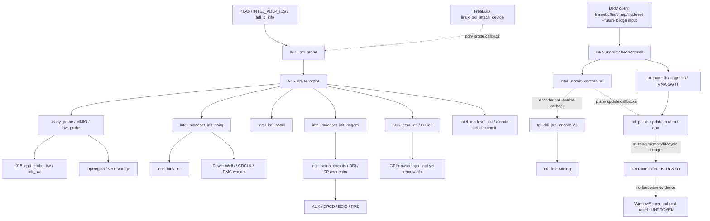

# Intel 46A6 真实源码路径与尚未闭合的桥接

**输入版本见 source-lock.json；层级 SOURCE-STATIC；不是完整预处理/对象可达性图。** 92 个函数定义、79 条直接调用或回调绑定记录见 [symbol-inventory.csv](symbol-inventory.csv)、[callgraph-edges.json](callgraph-edges.json) 与 [逐边表](callgraph-table.md)。

## 结构图

上图实线概括源码阶段依赖，**不是每条都为单跳 C 调用**；精确单跳只认逐边 JSON。虚线表示函数指针、对象关系或缺失接口，不能当已有桥接实现。

## 1. PCI、对象与分阶段初始化

继承 R1.4-B 已确认的 `46A6→INTEL_ADLP_IDS`，本轮继续定位 [i915_pci.c](https://github.com/freebsd/drm-kmod/blob/dba60e1e9465d4d6b2d4e7916174f7b915c35fb4/drivers/gpu/drm/i915/i915_pci.c#L990) 的 `adl_p_info`、`XE_LPD_FEATURES`（display IP 13）和 `i915_pci_driver.probe=i915_pci_probe`。FreeBSD [linux_pci_attach_device](https://github.com/freebsd/freebsd-src/blob/8c9ce319fef765890ce518cab85d3a470b669849/sys/compat/linuxkpi/common/src/linux_pci.c#L490) 通过 `pdrv->probe` 交付；这依赖 BSD `device_t`、PCI resource 和 Linux `pci_dev` 的 host 适配，XNU 对应提供者未实现。

[i915_driver_probe](https://github.com/freebsd/drm-kmod/blob/dba60e1e9465d4d6b2d4e7916174f7b915c35fb4/drivers/gpu/drm/i915/i915_driver.c#L895) 实际顺序：create → PCI enable → early probe → GT probe → MMIO probe → hw probe → modeset_noirq → IRQ install → modeset_nogem → GEM init → modeset init → register。每段有错误跳转和资源清理，不能把这些函数当成可任意拼装的名单。

`drm_i915_private` 持有 drm device、display/power/OpRegion、GGTT、GT、工作队列和 locks；`drm_i915_gem_object→i915_vma→drm_framebuffer→intel_plane_state` 构成 scanout 生命周期。类型字段和 layout 必须用实际 headers/config 核验，未生成 XNU 对象 ABI。

## 2. VBT、显示电源、时钟与连接器

hw probe 先设置 `intel_opregion_setup()`；noirq 阶段再 `intel_bios_init()` 解析存放在 `display.opregion.vbt` 的数据。**不是虚构 `intel_bios_init→intel_opregion_get_vbt` 调用**。VBT 缺失时上游有默认分支，但本机 panel 参数未知，不能把这些默认值当本机事实。

noirq 中 `intel_power_domains_init_hw()` 对 `DISPLAY_VER>=11` 调用 `icl_display_core_init()`，随后保持 `POWER_DOMAIN_INIT` 引用；core init 含 CDCLK/Power Well 状态操作。nogem 建立 CRTC、shared DPLL、初始时钟和输出；`intel_setup_outputs→intel_ddi_init→intel_ddi_init_dp_connector→intel_dp_init_connector`。

DP connector 先初始化 AUX，再 `intel_edp_init_connector()`：panel VBT → PPS → DPCD → EDID（可能用 OpRegion EDID）→ panel/backlight。AUX 实际绑定 `aux.transfer=intel_dp_aux_transfer`，再到 `intel_dp_aux_xfer`，需锁、电源引用、MMIO、waitqueue/超时与 IRQ 完成，不能只返回 ACK。

## 3. Link training 与 plane 是回调路径

`intel_ddi_init` 绑定 `encoder->pre_enable=intel_ddi_pre_enable`；modeset 中 encoder 调度经 `intel_encoders_pre_enable()` 调用该指针。ADL-P display IP 13 经 `intel_ddi_pre_enable_dp` 的 `>=12` 分支到 `tgl_ddi_pre_enable_dp`，包含 clock/PHY/PPS/link training。`intel_dp_start_link_train→intel_dp_link_train_all_phys`，训练之后还需 `intel_dp_stop_link_train`。**注册绑定存在不等于本机训练成功**。

`skl_universal_plane_create()` 对 `DISPLAY_VER>=11` 实际绑定 `icl_plane_update_noarm/arm`，不是因为源文件叫 skl 就认定 ADL-P 执行旧 skl callback。noarm 写 stride/尺寸/offset，arm 提交 control/surface 等，surface 依赖真实 `intel_plane_state` view 与 GGTT backing。不能使用 BIOS stolen 起点替代该对象。

## 4. GEM/GGTT 和 XNU 发布的断点

`intel_prepare_plane_fb→intel_plane_pin_fb→intel_pin_and_fence_fb_obj` 需要 reservation/ww locks、page pin、VMA、fence/pin flags 与 runtime PM。`i915_gem_object_pin_to_display_plane` 的真实定义在 `gem/i915_gem_domain.c`，再到 `i915_gem_object_ggtt_pin_ww→i915_vma_pin_ww→i915_vma_bind`；后者通过 bind ops 到 GGTT 提供者。`skl_plane_surf` 从 `intel_plane_ggtt_offset` 和 surface view 得到扫描偏移。GGTT 页表插入取 DMA scatterlist 地址，并非 CPU 物理连续性的保证。`i915_gem_init→intel_gt_init→intel_uc_init` 中后者由宏/ops 生成；`__uc_init` 定义已定位，但条件 ops 选择、宏展开与完整闭包未完成。

`drm_client_framebuffer_create`、`drm_client_buffer_vmap` 和 `drm_client_modeset_commit` 是**未来桥接可研究的公开输入**。它们不是 i915 probe 直接调用的新 XNU 输出路径。本项目没有 C ABI bridge 或 IOFramebuffer subclass，不存在已实现的 publication symbol。

继承 Apple 15.5 API：`getInformationForDisplayMode` 返回模式信息；`getApertureRange` 提供内存描述符；模式、像素格式、连接/中断与同步 stop 都需单独契约。仍无法证明 CPU/IO aperture 映射、WindowServer 在线无加速桌面及真实内屏刷新。

## 5. 线程、中断和模块边界

- probe、VBT、连接器发现、GEM pin 与 atomic commit 需要可睡眠 process/worker 语境；不是证明它们可在 XNU workloop gate 任意阻塞。
- `gen11_irq_handler` 是 Linux IRQ callback；BSD LinuxKPI 有自己的 interrupt adapter。实际 FreeBSD/XNU 交付上下文、IRQ mask 与原子锁语义尚未闭合。
- DMC `dmc_load_work_fn` 是 worker，销毁前必须同步 drain；`linux_cancel_work_sync` 使用 BSD taskqueue cancellation/drain，不能直接把它替换为 timer 停止。
- encoder/plane/MMIO callbacks 的 locks、preemption、错误传播须在预处理后的调用者链中继续审查。

因此目前能确认必须研究 PCI/LinuxKPI、DRM atomic/KMS/client/GEM/fence、i915 display/power/AUX/GGTT 和完整 probe 所牵涉的 GT；**尚不能给出可编译的 Intel-only 最小对象全集**。未引入 AMD/xe/NVIDIA，但不以删文件证明它们与共享模块没有符号依赖。
